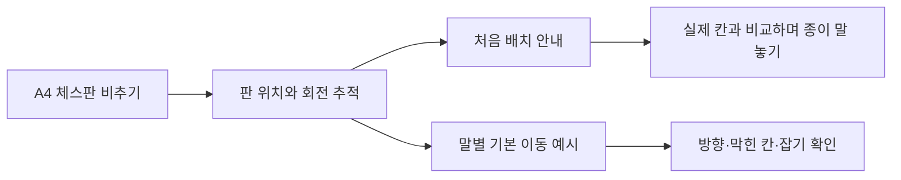

# 체스 연습의 목적과 구조

체스를 처음 접하면 설명서의 좌표·말 이름을 실제 판의 위치와 연결하는 데 시간이 걸립니다. 이 앱은 **판의 해당 칸 위에 배치와 이동 예시를 겹쳐 보여주는 것**을 목표로 합니다. 가상 말과 실제 칸을 같은 자리에서 비교할 수 있다는 점이 AR을 사용하는 이유입니다.

수업에서 배운 **등록 이미지 인식 → 위치에 가상 콘텐츠 표시 → 버튼으로 내용 전환**을 이용합니다. 새로운 사물 인식 모델이나 실시간 경기 판정은 필요하지 않습니다.

## 사용 흐름

처음 배치는 **방향 → 흰 폰 → 흰 뒷줄 → 검은 폰 → 검은 뒷줄**의 다섯 단계입니다. 이동법은 폰·룩·나이트·비숍·퀸·킹마다 미리 정한 예시 배치를 사용합니다. 이동할 수 있는 칸은 그 예시의 다른 말에 의해 막히거나 잡을 수 있는 위치를 반영합니다.

판을 놓치면 가상 표시를 숨깁니다. 같은 판을 다시 인식할 때 학습 단계를 초기화하지 않고 이어갑니다. 사용자는 판이나 기기를 움직여 입체 말을 다른 각도에서 볼 수 있습니다.

## 자료와 실측 기준

| 자료 | 역할 |
| --- | --- |
| [ChessBoard.pdf](ChessBoard.pdf) | 실제 크기 100%로 인쇄할 A4 체스판 |
| [PaperPieces.pdf](PaperPieces.pdf) | 구매 없이 사용할 흰 말 16개·검은 말 16개 |
| `Assets/ChessAR/Resources/Chess/BoardTarget.png` | AR에 등록한 원본 전체 그림 |
| `Tools/generate_chess_printables.py` | 출력물 생성과 칸 색·크기 검증 |

참조 이미지 전체 크기는 **210 × 297mm**입니다. 8×8 격자는 종이 중앙에 **176 × 176mm**, 한 칸은 **22mm**로 배치합니다. 이미지의 중심과 격자의 중심을 같게 두어 같은 좌표 계산을 등록 이미지와 3D 모형에 사용합니다.

- 파일은 왼쪽부터 a–h, 랭크는 아래부터 1–8입니다.
- a1은 어두운 칸이고 h1은 밝은 칸입니다.
- 흰 퀸은 d1의 밝은 칸, 검은 퀸은 d8의 어두운 칸에 놓습니다.
- 제목·좌표·기호표·배치 설명은 반복 격자 외의 인식 특징을 제공합니다. 실제 추적 안정성은 기기 시험이 필요합니다.

## 코드의 역할

| 구분 | 경로 | 역할 |
| --- | --- | --- |
| 체스 규칙·좌표 | `Assets/ChessAR/Scripts/Core/ChessRules.cs` | 칸, 말, 초기 배치, 기본 이동, A4상의 위치 계산 |
| 학습 상태·예시 | `Assets/ChessAR/Scripts/Core/ChessLessonState.cs` | 다섯 배치 단계와 여섯 종류의 이동 예시·설명 |
| 입체 표시 | `Assets/ChessAR/Scripts/ChessBoardVisual.cs` | 말과 칸 표시를 만들어 학습 내용을 그림 위에 보여줌 |
| 앱·이미지 추적 | `Assets/ChessAR/Scripts/` | 화면 입력, 등록 판 추적, 표시 숨김·재개, 미리보기 연결 |
| 장면·참조 이미지 준비 | `Assets/ChessAR/Editor/ChessSetup.cs` | 별도 체스 장면과 `Chess/BoardImages` 라이브러리 생성 |
| 회귀 검사 | `Tests/ChessRegression` | Unity 없이 체스 규칙·학습 상태·실측 좌표 확인 |

등록 이미지의 이름은 `chess_board`이며, 라이브러리는 `Resources/Chess/BoardImages.asset`로 생성합니다. 기기 빌드 전에 실제 이미지 데이터를 준비하도록 설정합니다. 미리보기는 3D 모형의 사용 예시이고, 실제 카메라 인식 성공을 흉내 내지 않습니다.

## 기존 프로젝트와의 구분

새 브랜치는 **`codex/chess-ar-learning-20261031`**이며, 기존 분리배출 브랜치는 **`codex/seongbuk-ar-starter-20261022`**에 유지합니다. 새 소스·생성 장면은 `Assets/ChessAR`에 둡니다. 이전 소스 파일이 저장소에 남아 있어도 체스 장면은 기존 분리배출 앱을 생성하지 않습니다.

명시적인 **Chess AR → 1. Create Chess Scenes** 작업에서 체스 장면을 빌드 대상으로 설정하고, 제품 이름을 `Chess FirstMove`, 앱 ID를 기존 ID 뒤에 `.chess`를 붙인 값으로 준비합니다. 자동 임포트만으로 기존 장면이나 앱 ID를 바꾸지 않습니다. Xcode 출력도 `Builds/ChessAR-iOS` 같은 새 폴더로 구분합니다.

## 현재 범위와 검증

- **35개 순수 C# 검사 통과**: 초기 32개 배치·퀸 위치, 말별 기본 이동·막힘·잡기, 폰 양방향, 전 칸의 경계, 회전 대칭, A4 좌표, 단계 전환.
- 이동은 학습용 기본 패턴이며 **체크·왕의 안전·캐슬링·앙파상·승격**을 처리하지 않습니다. 따라서 현재 경기에서 둘 수 있는 합법 수 전체를 표시하는 엔진으로 설명하지 않습니다.
- 종이 말의 실제 위치나 사용자가 올바르게 배치했는지는 카메라로 자동 판정하지 않습니다. 사용자가 가상 예시와 직접 비교합니다.
- 이번 체스 앱의 Unity UI·3D 렌더링·이미지 추적·Xcode 실행은 개발 환경에서 검증하지 못했습니다. 기기 빌드 후 확인합니다.

## 발표 예시

> 「Chess FirstMove」는 체스를 처음 배우는 사람을 위한 이미지 인식 AR 학습 도구입니다. 출력한 게임판을 비추면 처음 놓을 말의 위치와 기본 이동 예시가 실제 칸 위에 나타납니다. 설명서의 좌표를 판에 옮겨 읽는 대신 같은 자리에서 비교하도록 구성했습니다. A4 판과 종이 말을 사용해서 별도 체스 세트 없이 시연할 수 있습니다. 등록한 판의 위치와 회전을 추적하고, 사용자가 버튼으로 배치 단계와 말 종류를 선택합니다. 현재는 처음 배치와 기본 이동 학습을 구현했으며, 실제 말의 위치 인식이나 경기 판정은 범위에 포함하지 않았습니다.

[실행 순서로 돌아가기](../../START_HERE.md)
