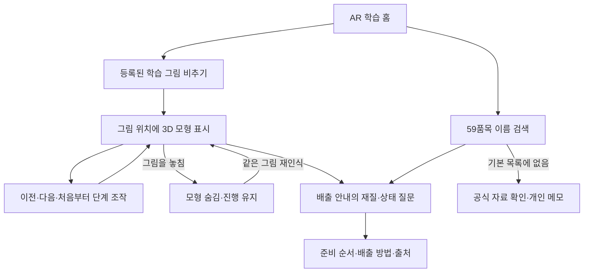

# 「어디다 버려?」 프로젝트 구조 설명

이 프로젝트는 **그림 위에 분리배출 과정을 입체로 보여주는 AR 학습 앱**입니다. 미리 등록한 페트병·배달 용기 그림을 비추면 해당 이미지의 위치에 가상 모형을 표시하고, 사용자가 단계를 넘기며 부품 분리와 배출 준비 과정을 봅니다.

## 사용자가 경험하는 순서

페트병은 **전체 보기 → 뚜껑 열기 → 라벨 제거 → 몸통 압착 후 뚜껑 다시 닫기**, 배달 용기는 **전체 보기 → 뚜껑 분리 → 오염 확인 → 배출 준비**를 보여줍니다. 같은 그림을 다시 인식해도 단계를 처음으로 돌리지 않고, 다른 등록 그림을 선택하면 그 물건의 첫 단계로 시작합니다.

## AR은 어느 부분인가

AR Foundation의 이미지 추적 기능이 **미리 등록한 평면 그림의 위치·회전**을 찾습니다. 그 자세를 3D 모형에 적용하므로 그림을 움직이거나 보는 각도를 바꾸면 모형도 그 그림에 맞춰 보입니다. 이미지가 추적되지 않으면 모형을 숨깁니다.

이 프로젝트에서 AR을 사용하는 목적은 글만으로 설명하던 **뚜껑 열기, 라벨 분리, 몸통 압착 같은 과정을 입체로 관찰하게 하는 것**입니다. 모형은 학습용으로 만든 가상 물체이며, 실제 병을 물리적으로 분해하거나 실제 뚜껑·라벨의 위치를 개별 인식하지 않습니다.

인식 대상은 **페트병·배달 용기 학습 그림 2종**입니다. 임의의 실물이나 59품목 전체를 자동으로 구분하는 기능이라고 설명하지 않습니다. `GuidePreview`의 선택형 3D 미리보기와 실제 기기의 이미지 추적도 구분합니다.

## 주요 파일과 역할

| 역할 | 파일 | 하는 일 |
| --- | --- | --- |
| 화면과 학습 흐름 | `Scripts/GuideApp.cs` | AR 홈, 단계 조작, 미리보기, 검색·질문·결과·메모 화면을 연결합니다. |
| 공통 화면 구성 | `Scripts/GuideUi.cs` | 글꼴, 버튼, 목록, 입력창, 안전 영역을 구성합니다. |
| 이미지 추적 연결 | `Scripts/CardGuideTracker.cs` | 등록 그림을 추적하고 해당 자세에 모형을 표시하며, 추적을 놓치면 숨깁니다. |
| 학습 상태와 문구 | `Scripts/Learning/WasteLesson.cs` | 품목별 단계, 이전·다음·재시작, 같은 그림 재인식 시 진행 유지를 관리합니다. |
| 입체 모형 | `Scripts/Learning/WasteLessonVisual.cs` | 페트병·뚜껑·라벨·용기 모형과 단계별 움직임을 만듭니다. |
| 등록 그림 준비 | `Editor/ImageArLessonSetup.cs` | 원본 그림 2종으로 Unity 참조 이미지 라이브러리를 생성·검사합니다. |
| 시작 장면 준비 | `Editor/StarterSetup.cs` | 기존 장면을 보존하면서 새 프로젝트의 미리보기·AR 장면을 준비합니다. |
| 품목과 질문 구조 | `Scripts/WasteCatalog.cs` | 검색 품목, 조건 질문과 결과 연결을 검사합니다. |
| 배출 안내 데이터 | `Resources/Data/seongbuk-demo.json` | 검색할 59품목, 상태 질문, 결과와 출처를 저장합니다. |
| 개인 메모 | `Scripts/Notes/` | 기기에 메모를 저장하고 검색·수정·삭제합니다. |

경로는 `Assets/SeongbukAR/`를 기준으로 합니다. 이전 사진 분류 구현인 `Scripts/Scanning/`, `WasteRecognition.cs`, `Plugins/iOS/SeongbukVision.mm`와 표면 배치 구현인 `SpatialGuide.cs`도 남아 있지만, 현재 기본 학습 화면의 중심은 등록 이미지 추적과 3D 과정 표시입니다.

## 그림과 모형이 연결되는 방식

원본 이미지 `Art/pet_bottle.png`, `Art/plastic_container.png`를 **전체 가로 12cm**로 등록합니다. 참조 이미지 이름은 배출 데이터의 품목 ID인 `pet_bottle`, `plastic_container`와 같습니다. 따라서 인식한 그림의 ID로 해당 학습 단계와 배출 안내를 함께 찾을 수 있습니다.

Editor에서 자동 준비하는 라이브러리는 `Resources/Tracking/WasteLessonImages.asset`입니다. 현재 코드가 이 리소스로 이미지 매니저를 구성하므로 기존 `GuideAR` 장면을 다시 만들지 않아도 됩니다. 준비를 다시 실행할 때는 **Seongbuk AR → 4. Prepare Image AR Lesson**을 사용합니다.

그림 전체를 인식하므로 글씨·특징 무늬를 잘라내지 않습니다. [AR_TEST_CARDS.pdf](../AR_TEST_CARDS.pdf)를 인쇄하거나 다른 화면에 띄워 사용할 수 있으며, 실제 표시 폭·빛 반사·모아레 등에 따른 기기 추적은 별도 확인합니다.

## 배출 정보와 사용자 확인

학습 모형의 움직임은 절차를 설명하는 예시입니다. 실제 물건의 재질이나 오염 제거 가능 여부를 판정하지 않습니다. 배출 안내에서는 사용자가 실제 물건을 보고 재질·남은 내용물·세척 상태에 답합니다.

페트병 예시는 투명한 생수·음료 페트병을 대상으로 합니다. 뚜껑을 여는 단계를 보여주되 마지막에는 **압착 후 뚜껑을 다시 닫습니다.** 라벨은 표시된 재질과 지역 수거 안내를 확인합니다. 배달 용기는 단순 변색과 남은 음식물·기름을 구분하고, 세척이 가능한지 직접 확인합니다.

59품목 안내는 JSON 데이터로 관리합니다. `id`, `name`, `aliases`는 검색에, `startNodeId`, `nodes`, `choices`는 상태 질문에, `destination`, `steps`, `sourceUrls`는 배출 안내와 근거 표시에 사용합니다. **검색 데이터를 추가하는 것과 새 이미지 AR 대상을 등록하는 것은 별개 작업**입니다. 새 AR 대상에는 등록 그림과 그 대상의 모형·단계가 필요합니다.

개인 메모는 기본 안내와 구분하는 기기 내 사용자 기록입니다. 공유 서버, 공식 검수, 사진 인식 재학습에 반영하지 않습니다. 저장 위치는 `Application.persistentDataPath/personal-waste-notes.json`이며 앱 삭제 시 사라질 수 있습니다.

## 현재 구현과 검증 범위

- 등록 이미지 AR 학습은 **2종**, 검색·상태별 배출 안내는 **59품목**입니다.
- 학습 상태의 순수 C# 검사 13개는 같은 이미지 재인식, 품목 변경, 단계 범위, 재시작과 문구 일관성을 검사합니다.
- 기존 카탈로그·인식 후보 34개, 스캔 응답·사진 방향·영역 18개, 개인 메모 15개 검사도 있습니다. 순수 C# 검사는 Unity 렌더링이나 실제 AR 추적 시험을 대체하지 않습니다.
- 기존 버전의 설치·실행은 사용자 iPad Air 11형(M3), iPadOS 26.5에서 확인했습니다. 이번 수정본의 Unity/Xcode 빌드·모형 표시·실제 이미지 추적 품질은 기기에서 확인해야 합니다.
- 자료는 전국 공통·서울시·다른 자치구 참고 정보를 포함합니다. 성북구 전체 배출 규칙을 검수받았다고 설명하지 않습니다. 근거는 [catalog-sources.md](catalog-sources.md)에 정리했습니다.

## 발표 설명 예시

> 「어디다 버려?」는 그림 위에서 분리배출 과정을 배우는 이미지 인식 AR 앱입니다. 등록한 페트병이나 배달 용기 그림을 비추면 그 위치에 가상 모형이 나타납니다. 단계를 넘기면서 뚜껑을 열고 라벨을 분리하거나 몸통을 압착하는 과정을 여러 각도에서 볼 수 있습니다. 그림을 놓치면 모형이 숨겨지고 다시 비추면 보던 단계가 이어집니다. 실제 물건의 재질과 오염 상태는 사용자가 확인하며, 자세한 배출 안내와 출처는 기존 질문 화면에서 볼 수 있습니다. AR 학습 그림은 두 종류이고, 보조 검색에는 59품목의 안내를 담았습니다.

기기 시험 후에는 실제로 추적된 그림, 화면에서 확인한 과정, 추적이 어려웠던 조명·각도 같은 관찰 결과를 덧붙입니다. 아직 확인하지 않은 기기 동작이나 인식률을 발표에서 성공한 결과로 설명하지 않습니다.
