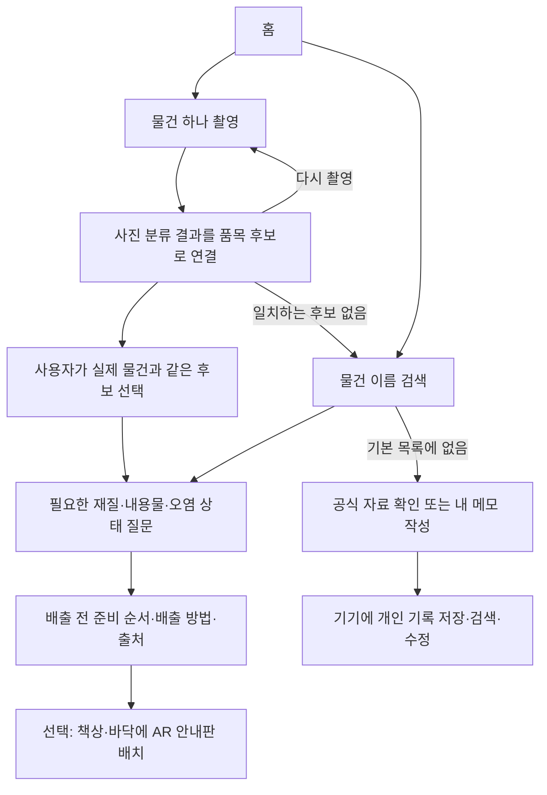

# 「어디다 버려?」 프로젝트 구조 설명

이 프로젝트는 **물건을 촬영하거나 이름으로 찾고, 재질과 상태를 확인한 뒤, 배출 방법을 안내하는 Unity 앱**입니다. 사용 장소는 성북구를 대상으로 기획했습니다. 아이폰에서는 결과 안내를 실제 책상·바닥 위에 놓는 AR 기능을 사용합니다.

## 사용자가 경험하는 순서

사진에 나온 물건을 최종 확정하는 사람은 사용자입니다. 물건 이름을 확인한 뒤에는 미리 정리한 질문과 선택지에 따라 결과로 이동합니다. 추가 확인이 필요 없는 품목은 곧바로 결과가 나옵니다. 인식 후보가 맞지 않거나 스캔이 어려운 물건은 이름 검색으로 같은 안내를 확인할 수 있습니다.

기본 목록에도 없는 물건은 공식 품목사전·성북구 수거 안내를 확인하거나 **내 메모**에 기록합니다. 이름만 먼저 저장하고, 확인한 내용과 참고 링크를 나중에 추가할 수 있습니다. 인식 실패가 앱 사용의 끝이 되지 않도록 대체 경로를 둔 구조입니다.

## 내부에서는 어떤 부분이 일을 나누는가

| 역할 | 실제 파일 | 발표할 때 설명할 말 |
| --- | --- | --- |
| 화면의 흐름 관리 | `GuideApp.cs` | 홈, 촬영, 후보 선택, 상태 질문, 결과, AR 화면 사이의 이동을 관리합니다. 현재 품목과 답변 이력도 기억합니다. |
| 화면 모양 만들기 | `GuideUi.cs` | 글꼴, 색, 버튼, 목록, 입력창, 스크롤을 공통 방식으로 만듭니다. 화면 크기와 아이폰 안전 영역에 맞춰 배치합니다. |
| 카메라 사진 준비 | `Scanning/WasteScanController.cs` | AR 카메라에서 사진 한 장을 가져오고 중앙 부분을 잘라 사진 분류기로 전달합니다. 촬영 사진의 방향, 취소, 시간 초과도 처리합니다. |
| 아이폰 사진 분류 | `Plugins/iOS/SeongbukVision.mm` | Apple Vision의 기존 사진 분류 기능을 호출합니다. 분석은 아이폰 안에서 이루어지며 사진을 서버로 보내지 않습니다. |
| 분류 결과와 품목 연결 | `WasteRecognition.cs` | 분류기가 돌려준 이름을 앱의 품목 목록과 연결해, 기본 최대 3개의 확인 후보를 만듭니다. |
| 품목·질문·결과 저장 | `Resources/Data/seongbuk-demo.json` | 품목 이름, 검색 별칭, 재질·오염 질문, 선택지, 준비 순서, 배출 방법과 출처를 저장합니다. |
| 데이터 읽기와 검사 | `WasteCatalog.cs` | JSON 파일을 읽은 구조를 검사하고, 품목 ID나 이름·별칭으로 찾습니다. 선택지의 다음 질문 연결이 잘못되어 있으면 오류를 알립니다. |
| 개인 기록 관리 | `Scripts/Notes/PersonalWasteNotes.cs` | 직접 적은 물건의 이름·재질·메모·참고 링크를 검색·수정·삭제하고, 기본 안내와 구분합니다. |
| 개인 기록 파일 저장 | `Scripts/Notes/PersonalWasteNoteStore.cs`, `PersonalWasteNoteFile.cs` | 기기의 저장 경로에 JSON 파일로 기록해 앱 재실행 후에도 불러옵니다. |
| 현실 공간에 안내 배치 | `SpatialGuide.cs` | AR Foundation과 ARKit으로 표면을 찾고, 사용자가 선택한 위치에 배출 안내판을 만듭니다. |

프로젝트 경로의 기준은 `Assets/SeongbukAR`입니다. 표의 `Resources`·`Plugins`·`Scripts` 파일은 이 폴더 아래에 있습니다. `GuideApp.cs`, `GuideUi.cs`, `WasteRecognition.cs`, `WasteCatalog.cs`, `SpatialGuide.cs`는 `Scripts` 폴더에 있습니다.

사진 인식 쪽은 **카메라 사진 → Apple Vision의 분류 이름 → 앱의 품목 후보** 순서입니다. 예를 들어 분류기에서 병이라는 이름이 나오면 사진만으로 재질을 확정하지 않고 페트병·유리병 같은 후보를 확인하게 합니다. 빨간색, 기름, 플라스틱처럼 넓은 분류 이름만으로 배출 방법을 정하지 않습니다.

개발 도구의 역할도 구분할 수 있습니다. **Unity**에서는 앱의 장면·화면·동작을 구성하고, **VS Code**에서는 C# 코드를 편집합니다. 맥북에서 직접 아이폰에 설치할 때에는 Unity가 내보낸 프로젝트를 **Xcode**에서 빌드·서명해 실행합니다.

## 엽떡·마라탕 용기로 설명하는 실제 예

`엽떡 용기`, `마라탕 용기`, `배달 용기`는 데이터에서 같은 **배달 플라스틱 용기** 품목을 찾는 검색 별칭입니다. 사진 분류기가 브랜드나 음식 이름까지 구분하는 기능은 없습니다.

현재 데이터의 질문 연결은 다음과 같습니다.

| 확인 순서 | 사용자의 답변 | 다음 안내 |
| --- | --- | --- |
| 1. 바닥의 표시 등을 확인했을 때 플라스틱 용기인가? | 맞다 | 남은 음식물·기름 제거 여부 질문 |
| 1. 바닥의 표시 등을 확인했을 때 플라스틱 용기인가? | 다른 재질이거나 모른다 | 재질·용도와 공식 품목 안내를 더 확인하도록 안내 |
| 2. 음식·국물을 비우고 기름·찌꺼기를 제거했는가? | 제거했다 | 플라스틱류 배출 준비와 방법 |
| 2. 음식·국물을 비우고 기름·찌꺼기를 제거했는가? | 아직 남았다 | 세척해서 제거할 수 있는지 질문 |
| 3. 기름·음식물 찌꺼기를 제거할 수 있는가? | 세척할 수 있다 | 세척 후 플라스틱류 배출 준비와 방법 |
| 3. 기름·음식물 찌꺼기를 제거할 수 있는가? | 제거하기 어렵다 | 음식·국물을 먼저 분리하고, 오염 제거가 어려운 용기의 종량제 배출 안내 확인 |
| 3. 기름·음식물 찌꺼기를 제거할 수 있는가? | 재질·상태를 모른다 | 재질과 공식 안내를 더 확인하도록 안내 |

핵심은 **빨간 자국이 보인다는 사실과 실제로 음식물·기름이 남아 있다는 상태를 구분하는 것**입니다. 현재 앱은 세척 가능 여부를 사진으로 자동 판정하지 않습니다. 사용자가 실제 상태를 확인하고 답하도록 구성했습니다.

단추도 같은 구조를 사용합니다. `단추`로 검색해 옷에 달린 상태인지, 재질을 확인할 수 있는지 선택합니다. 작은 단추는 사진 인식이 어려울 수 있어 검색 기능이 필요합니다. 작은 금속 부품의 수거 여부처럼 지역 확인이 필요한 사항은 확인 안내와 출처를 보여줍니다.

## 데이터가 늘어날 때의 구조

JSON은 **내용을 일정한 형식으로 저장하는 텍스트 파일**입니다. 품목마다 별도의 화면이나 C# 스크립트를 만드는 대신, 같은 화면이 이 파일을 읽어 내용을 바꿉니다.

각 품목은 다음 정보를 가집니다.

- `id`, `name`, `aliases`: 품목을 구분하는 번호에 해당하는 ID, 화면 이름, 검색 별칭.
- `recognitionKeywords`: 사진 분류 이름과 연결할 구체적인 물건 이름.
- `startNodeId`, `nodes`: 시작 질문과 질문·결과 목록.
- `choices`와 `nextNodeId`: 선택지와 그 선택을 눌렀을 때 이동할 질문·결과.
- `destination`, `steps`, `explanation`: 배출 종류, 준비 순서, 참고 설명.
- `sourceUrls`, `sourceScope`, `sourceCheckedOn`: 참고 자료, 자료의 적용 범위, 확인 날짜.

그래서 새 품목의 이름·별칭·질문·결과·출처를 같은 형식으로 추가하면 기존 검색과 안내 화면을 재사용할 수 있습니다. **데이터에 품목을 추가했다고 사진 분류기가 그 물건을 새로 학습하는 것은 아닙니다.** 기존 분류기가 반환하는 이름과 연결할 수 있는지도 따로 확인해야 합니다.

## 인식 실패와 미등록 품목 처리

| 상황 | 사용자가 계속할 수 있는 행동 |
| --- | --- |
| 사진을 분석하지 못했거나 후보가 맞지 않음 | 밝은 곳에서 다시 촬영하거나 이름으로 검색 |
| 선택한 분류에서 결과가 보이지 않음 | 전체 분류에서 같은 이름으로 검색 |
| 기본 목록에서도 찾지 못함 | 공식 품목사전·성북구 수거 안내 확인, 내 메모 작성 |
| 배출 방법을 아직 모름 | 이름만 저장하고 확인할 내용을 나중에 추가 |
| 전에 기록한 물건을 다시 찾음 | 홈의 내 메모 또는 일반 이름 검색에서 열어 수정·삭제 |

개인 메모에는 이름을 필수로 입력하고 재질·상태, 메모, `https://` 참고 주소를 선택적으로 적습니다. 화면에는 **개인 메모·검증되지 않은 정보**임을 표시합니다. 사용자가 적은 내용은 기본 안내 59품목이나 인식 후보를 만드는 기준에 합치지 않습니다.

개인 기록은 `Application.persistentDataPath/personal-waste-notes.json`에 저장하며 공유 서버로 보내거나 다른 기기와 동기화하지 않습니다. 사진도 메모에 저장하지 않습니다. 앱 재실행 후에는 같은 기록을 불러오고, 앱을 삭제하면 기록도 사라질 수 있습니다. 사용자 메모가 공식 검수되는 서버나 사진 분류기를 재학습하는 기능은 현재 구현 범위에 포함하지 않습니다.

## AR은 어느 부분인가

물건 사진을 분석하는 기능은 **사진 인식**입니다. 결과 안내판을 실제 공간의 위치에 놓는 부분이 **증강현실**입니다.

사용자가 `공간에 안내 놓기`를 선택하면 ARKit이 찾은 책상·바닥 표면에 화면 가운데에서 광선을 쏘아 위치를 정합니다. 이것을 레이캐스트라고 합니다. 해당 위치에 품목 이름·배출 방법·최대 3개의 준비 단계를 담은 안내판을 표시하고, 글씨가 카메라 쪽을 향하게 합니다. 전체 준비 단계는 기존 결과 화면에서 확인합니다.

발표에서는 “실제 물건을 정리하는 공간에 안내를 놓고, 물건과 안내를 함께 보며 준비 순서를 확인하도록 했습니다”라고 설명할 수 있습니다. 현재 AR의 효용은 이 공간 안내입니다. 쓰레기에 자동으로 딱 붙어 움직이는 표시, 병뚜껑·라벨의 개별 위치 추적, 앱 재실행 후 같은 위치에 계속 남는 기능은 구현 범위에 포함하지 않았습니다. 그런 기능은 향후 발전 방향으로 구분해서 설명하면 됩니다.

## 현재 구현과 검증 범위

- 검색·상태별 안내 데이터는 **59품목**입니다. 59품목 모두를 카메라로 정확히 인식한다는 의미는 아닙니다.
- 쓰레기 전용 인공지능 모델을 새로 학습하지 않았습니다. 기존 Apple Vision 사진 분류기를 활용하고, 이 결과를 품목 확인·상태 질문·배출 안내·AR 표시로 연결하는 구조를 작성했습니다.
- 성북구 사용자를 대상으로 기획했지만, 자료에는 전국 공통·서울시·다른 자치구 참고 자료가 섞여 있습니다. 성북구 전체 배출 규칙의 검수를 마쳤다고 설명하면 안 됩니다. 데이터의 지역 검토 상태는 추가 확인이 필요합니다.
- 화면·스캔 연결·질문·AR 배치 코드는 작성되어 있습니다. C# 데이터·인식 후보·스캔 응답 처리 검사 36개가 통과했으며, 이 검사는 실제 사진 분류나 AR 화면을 실행하는 시험이 아닙니다.
- 개인 메모의 데이터·파일 처리는 `Tests/NotesRegression`의 15개 검사를 통과했습니다. 파일 입출력은 실제 구현을 검사하고, 검사 환경의 JSON 변환은 System.Text.Json을 사용합니다. 실제 Unity JsonUtility·입력창·아이폰 키보드·기기 저장 동작은 실행 확인이 필요합니다.
- 실제 Unity 화면 렌더링, Xcode 네이티브 컴파일, 아이폰에서의 인식 품질·AR 동작은 기기 빌드 후 확인해야 합니다. 기기 시험 뒤에는 이 항목을 실제 결과에 맞춰 갱신합니다.

## 45~60초 발표 예시

> 제가 기획한 「어디다 버려?」는 성북구 사용자를 대상으로 한 분리배출 안내 앱입니다. 물건을 촬영하면 아이폰의 Apple Vision 사진 분류 기능을 통해 품목 후보를 보여주고, 사용자가 실제 물건과 같은 항목을 선택합니다. 그다음 재질이나 남은 음식물, 기름 제거 가능 여부를 질문해서 상태에 맞는 배출 방법과 준비 순서를 안내합니다. 예를 들어 배달 용기는 플라스틱인지 먼저 확인하고, 오염을 제거할 수 있는지에 따라 안내가 달라집니다. 안내 내용은 JSON 데이터로 관리하며 현재 59품목을 검색할 수 있습니다. 결과는 실제 책상이나 바닥 위에 AR 안내판으로 놓을 수 있습니다. 사진 분류기를 새로 학습한 것은 아니며, 기존 분류 결과와 상태별 배출 안내를 연결하고 AR로 보여주는 구조를 구성했습니다.

기기 시험 전에는 “아이폰에서 실제 인식 품질과 AR 동작을 확인할 예정입니다”라고 덧붙입니다. 기기 시험 후에는 성공한 사례, 인식이 어려웠던 사례, 보완한 점을 실제 관찰 내용으로 설명합니다.

실패 대응은 “인식이 어려우면 재촬영이나 검색으로 이어지고, 아직 목록에 없는 물건은 개인 메모로 저장해 나중에 확인한 내용을 추가할 수 있도록 했습니다”라고 설명할 수 있습니다. 이 기록이 사진 인식을 자동으로 학습시킨다고 설명하지 않습니다.
